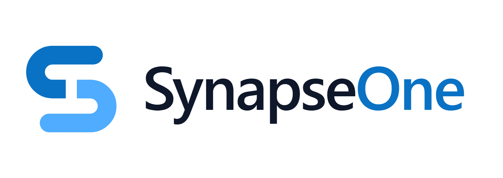
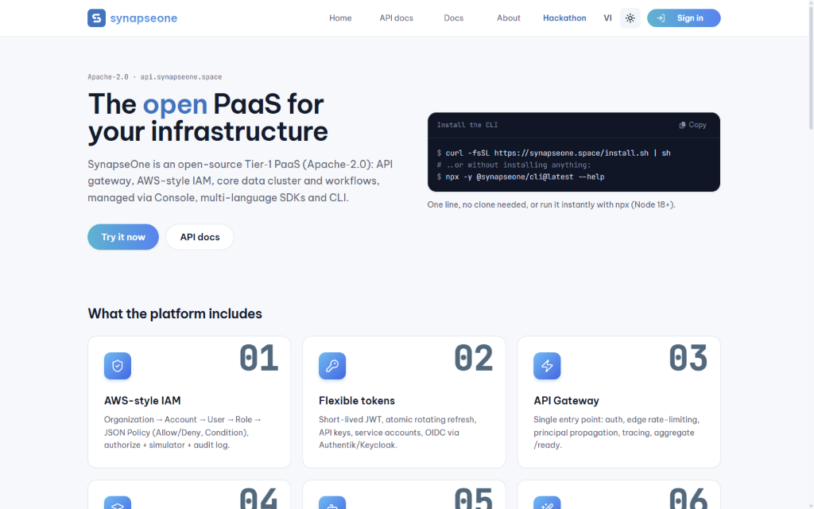
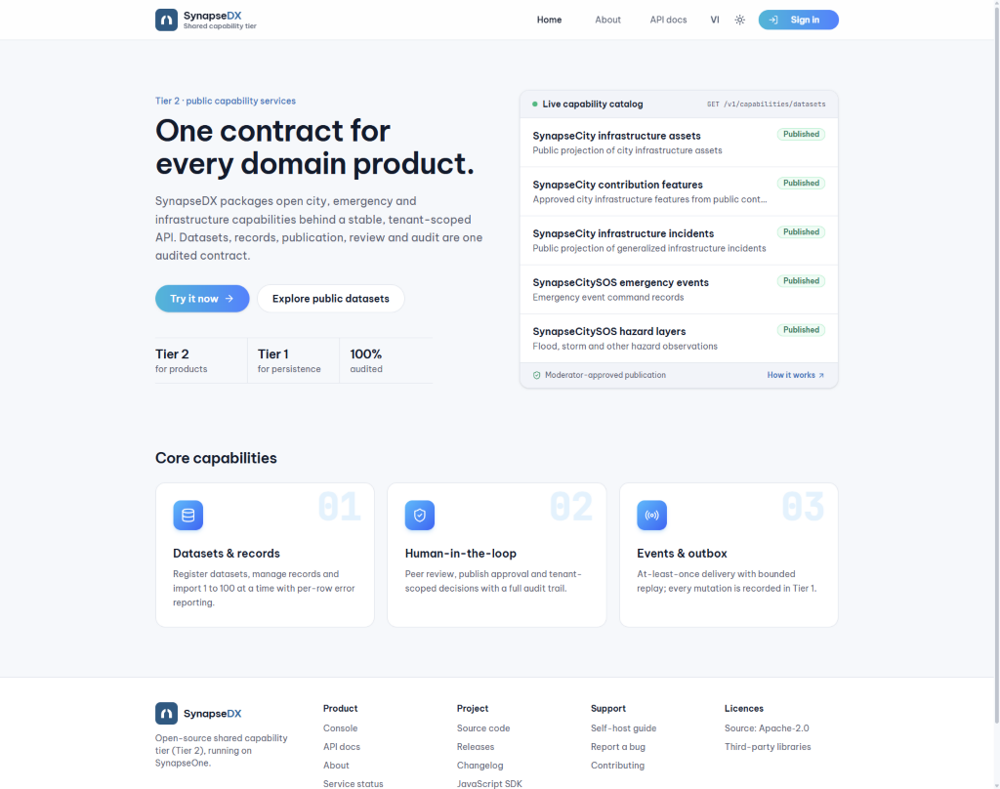
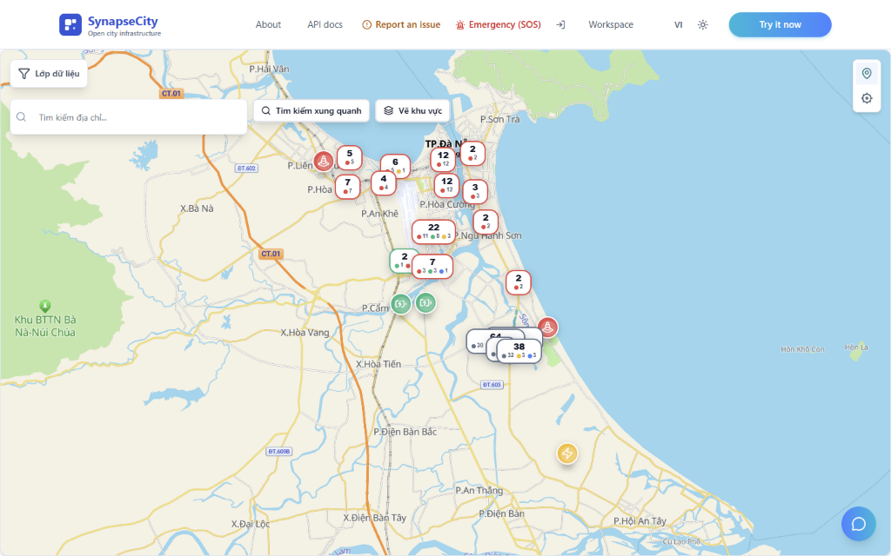
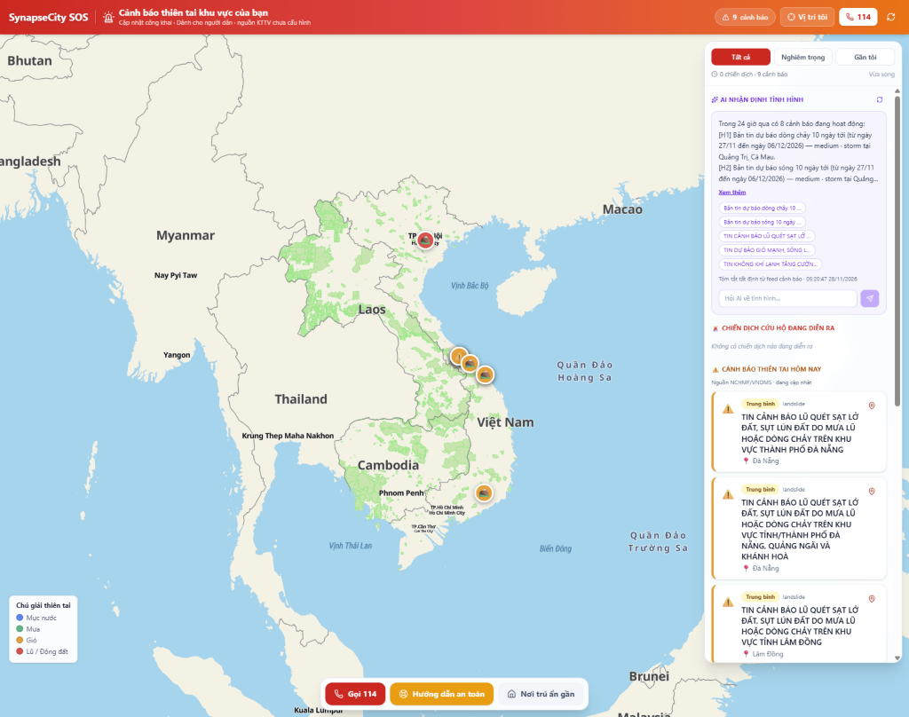

<p align="center">
  <picture>
    <source media="(prefers-color-scheme: dark)" srcset="./assets/synapseone-logo-dark.png">
    
  </picture>
</p>

<h2 align="center">VKU Open Source 2026 — The Synapse DX-OS Ecosystem</h2>

<p align="center">
  Open-source 3-tier Digital Transformation Operating System (DX-OS) for cloud infrastructure, open data governance, smart-city operations, and disaster response.<br>
  Built at <strong>Vietnam–Korea University of Information and Communication Technology (VKU)</strong> for <strong>OLP Open Source Software 2026</strong>.
</p>

<p align="center">
  
  
  <a href="https://synapseone.space"></a>
  <a href="https://synapsedx.sbs"></a>
  <a href="https://synapsecity.sbs"></a>
  <a href="https://sos.synapsecity.sbs"></a>
</p>

---

## Three-Tier DX-OS Architecture

Every product in the Synapse family obeys a strict **top-down contract** with zero database sharing or lateral service coupling:

```text
┌───────────────────────────────────┬───────────────────────────────────┐
│  SynapseCity (Tier 3)             │  SynapseCitySOS (Tier 3)          │
│  Urban infrastructure, GIS map,   │  Hazard feeds, live SSE alerts,   │
│  IoT telemetry, citizen reports   │  AI EOP, dispatch, SITREP & AAR   │
└─────────────────┬─────────────────┴─────────────────┬─────────────────┘
                  │     @synapsedx/capabilities       │
                  ▼                                   ▼
┌───────────────────────────────────────────────────────────────────────┐
│  SynapseDX (Tier 2 — Shared H-D-P-I Capability Layer & Workspace)     │
│  Human · Data (NGSI-LD / PostGIS / OLAP) · Process (HITL) · AI / OCR  │
└───────────────────────────────────┬───────────────────────────────────┘
                                    │  @synapseone/sdk
                                    ▼
┌───────────────────────────────────────────────────────────────────────┐
│  SynapseOne (Tier 1 — Headless Open PaaS)                             │
│  Gateway · AWS-style IAM · Base · Faststore · Queue · Stream ·        │
│  Warehouse · OCS (S3) · LDS · DAG Workflows · AI Inference            │
└───────────────────────────────────────────────────────────────────────┘
```

## Repositories

| Repository | Tier | Role | Live Deployment | Artifacts |
| :--- | :---: | :--- | :--- | :--- |
| [**SynapseOne**](https://github.com/vku-open-source-2026/SynapseOne) | **Tier 1** | Open PaaS: API gateway, IAM, document/KV/queue/stream/OLAP/S3 data cluster, NGSI-LD & workflows | [synapseone.space](https://synapseone.space)<br>[cloud.synapseone.space](https://cloud.synapseone.space) | `@synapseone/sdk` (npm)<br>`@synapseone/cli` (npm)<br>`synapseone-sdk` (PyPI)<br>Go & Rust SDKs · GHCR |
| [**SynapseDX**](https://github.com/vku-open-source-2026/SynapseDX) | **Tier 2** | Reusable **H-D-P-I** capability contract, open-data catalog, HITL approvals & unified workspace | [synapsedx.sbs](https://synapsedx.sbs)<br>[synapsedx.sbs/workspace](https://synapsedx.sbs/workspace) | `@synapsedx/capabilities`<br>`synapsedx` (Rust)<br>GHCR images |
| [**SynapseCity**](https://github.com/vku-open-source-2026/SynapseCity) | **Tier 3** | Urban infrastructure GIS registry, citizen incident reporting, IoT sensors & community GIS portal | [synapsecity.sbs](https://synapsecity.sbs)<br>[synapsecity.sbs/map](https://synapsecity.sbs/map) | GHCR images<br>Android APK + 4×3 Widget<br>PDDL-1.0 Open Data |
| [**SynapseCitySOS**](https://github.com/vku-open-source-2026/SynapseCitySOS) | **Tier 3** | Emergency operations: VNDMS hazard feeds, SSE stream, AI EOP drafts, dispatch, SITREP & AAR | [sos.synapsecity.sbs](https://sos.synapsecity.sbs)<br>[sos.synapsecity.sbs/map](https://sos.synapsecity.sbs/map) | GHCR images<br>Android APK + 4×3 Widget |

## Live Platform Showcase

| Tier 1 · SynapseOne (`synapseone.space`) | Tier 2 · SynapseDX (`synapsedx.sbs`) |
| :---: | :---: |
| [](https://synapseone.space) | [](https://synapsedx.sbs) |
| **Tier 3 · SynapseCity (`synapsecity.sbs/map`)** | **Tier 3 · SynapseCitySOS (`sos.synapsecity.sbs/map`)** |
| [](https://synapsecity.sbs/map) | [](https://sos.synapsecity.sbs/map) |

## Quickstart (Try in 60 Seconds)

Explore all three tiers directly against the live public deployments—no clone or API key required:

```bash
# Tier 1 — Inspect the PaaS CLI (Node.js 18+)
npx -y @synapseone/cli@latest --base https://api.synapseone.space --help

# Tier 2 — List published open-data datasets from SynapseDX
curl -s "https://synapsedx.sbs/v1/capabilities/datasets"

# Tier 3 (City) — Query published urban infrastructure assets (PDDL-1.0)
curl -s "https://synapsecity.sbs/v1/public/assets?limit=2"

# Tier 3 (SOS) — Fetch active disaster & weather hazard alerts
curl -s "https://sos.synapsecity.sbs/v1/hazards/recent?hours=24"
```

## SDK Usage & Self-Hosting

### Install Published SDKs

```bash
# Tier-1 PaaS SDKs (TypeScript & Python)
npm install @synapseone/sdk
pip install synapseone-sdk

# Tier-2 Capability Client (for domain apps & integrations)
npm install @synapsedx/capabilities
```

### Self-Host Any Tier with Docker Compose

Every repository ships reproducible `docker-compose.yml` stacks backed by public `Apache-2.0` images on `ghcr.io/vku-open-source-2026/*`:

```bash
git clone https://github.com/vku-open-source-2026/<RepoName>.git
cd <RepoName>
cp .env.example .env
docker compose pull && docker compose up -d --no-build
```

See each repository's README for tier-specific environment variables, source builds, and Android APK downloads.

## Open Source & Licensing

- **Source Code:** 100% [Apache License 2.0](https://www.apache.org/licenses/LICENSE-2.0) across all four repositories, with SPDX headers, `NOTICE`, and `THIRD-PARTY.md` inventories.
- **Open Data:** Published urban datasets in `SynapseCity` are released under **PDDL-1.0** (Open Data Commons Public Domain Dedication and License).
- **Issues & Contributions:** Open an issue or pull request in the target repository following its `CONTRIBUTING.md`.
